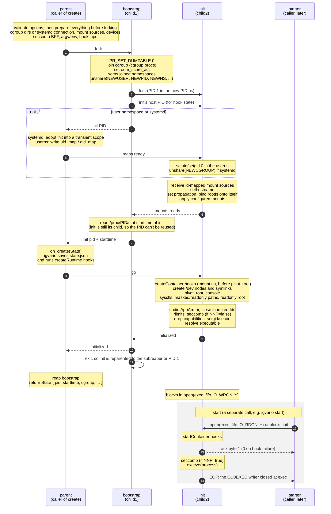

# libcontainer

A runc-style container library for Zig, built on Linux namespaces and cgroups. It is the
isolation layer under the `igvano` OCI runtime, and it ships as a standalone Zig module that
other projects can import without the CLI.

- Pure Zig, no C dependencies. Seccomp BPF, the cgroup v2 device filter and the systemd D-Bus
  client are all generated in Zig.
- Supports cgroup v1 and v2, with or without systemd, plus user namespaces, id-mapped mounts,
  seccomp, AppArmor, hooks and consoles.
- Has no OCI knowledge: callers pass already-translated options, never `config.json`.
  igvano's own `src/oci/` is one such translator.
- It compiles on any OS, but containers only run on Linux. Elsewhere, operations return
  `error.NotImplemented`.

## Installing

```sh
zig fetch --save git+https://github.com/igvano/igvano
```

```zig
// build.zig
const libcontainer = b.dependency("igvano", .{
    .target = target,
    .optimize = optimize,
}).module("libcontainer");
exe.root_module.addImport("libcontainer", libcontainer);
```

Requires Zig 0.16.0 or newer (`minimum_zig_version` in the repository's `build.zig.zon`).

## Usage

```zig
const libcontainer = @import("libcontainer");

var instance = libcontainer.linux.Container.create(.{
    .allocator = allocator,
    .id = "demo",
    .rootfs = "/abs/path/to/rootfs",
    .exec_fifo = "/run/demo/exec.fifo", // created by you (mkfifo) beforehand
    .process = .{ .args = &.{"/bin/sh"}, .cwd = "/", .uid = 0, .gid = 0 },
    .namespaces = &.{ .{ .kind = .mount }, .{ .kind = .pid } },
    .cgroup_path = "demo",
}) catch |err| {
    std.debug.print("create: {s}\n", .{libcontainer.linux.diagnostic() orelse @errorName(err)});
    return err;
};
defer instance.deinit(allocator);

const container = instance.container();
// ... start it (see "Starting"), then:
try container.kill(@intFromEnum(std.os.linux.SIG.TERM));
try container.delete();
```

[`examples/consumer`](../../examples/consumer) is a complete project that depends on this
repository by path and runs this flow.

## API

| Type | Purpose |
|---|---|
| `linux.Container` | The Linux implementation. `create(options)` starts init and leaves it paused before exec. `load(state)` reattaches to a container from persisted state. `adopt(state)` is like `load` but takes ownership of `starttime`. `deinit(allocator)` frees what the instance owns. `container()` returns the interface. |
| `Container` | Per-instance interface (`ptr` + vtable, in the style of `std.mem.Allocator`): `exec`, `alive`, `kill`, `killAll`, `update`, `pids`, `freeze`, `thaw`, `frozen`, `delete`, `diagnostic`. There is no `create` in the vtable, because construction belongs to the implementation. |
| `State` | The runtime data you persist between calls: id, pid, starttime (used to detect PID reuse), cgroup path, systemd flags, rootfs mount identity and device nodes. Store it after `create` and pass it to `load` later. |
| `CreateOptions`, `ExecOptions`, `Process`, `Namespace`, `IDMapping`, `Mount`, `Device`, `Resources`, `Capabilities`, `Rlimit`, `Hook`, `seccomp.Config`, ... | Already-translated settings. Each one's doc comment in `root.zig` gives its exact semantics. |
| `Error` | The library's error set. Pair it with `diagnostic()` to get the reason. |

## Starting

Like runc, `create` and start are separate steps. Init blocks on `exec_fifo` until you open it
for reading. It then runs the `start_hooks` and execs the process. To start the container, open
the FIFO `O_RDONLY` and read it until EOF, polling `container.alive()` so a dead init doesn't
leave you blocked. `waitForStart` in [`src/cli/start.zig`](../cli/start.zig) is the reference
implementation, including timeouts.

## How create works

`create` uses a double fork, as runc's `nsexec` does. The calling process (*parent*) prepares
everything before the first fork, because the forked processes must not allocate.
*Bootstrap* (child1) joins the cgroup and the namespaces, then forks *init* (child2). Init
becomes PID 1 in the new PID namespace. The processes coordinate over pipes, and each step
reports a failure, with its diagnostic, back to the parent.



Failure handling: when any step fails, the failing process writes the error and its
diagnostic to its pipe and exits. The parent then kills init if it was already reported,
reaps bootstrap, and cleans up: it stops the systemd scope, kills and removes the cgroup,
and detaches the rootfs self-bind. It then returns the error, with
the reason available from `linux.diagnostic()`.

## Caller contract

- **Privileges.** You need root, or a user namespace with `uid_mappings`/`gid_mappings`. You
  also need a writable cgroup hierarchy, or systemd (`systemd = true`).
- **Borrowed memory.** Every string and slice in the options and in `State` is borrowed: keep
  it alive while you use the instance. The one exception is `State.starttime` after `create`
  or `adopt`, which `deinit` frees with the same allocator. `deinit` does nothing on loaded
  instances.
- **Stable address.** A `Container` interface borrows its `linux.Container`, so don't move or
  copy the instance while the interface is in use.
- **Diagnostics are thread-local and borrowed.** Copy `diagnostic()` immediately after a
  failed call. The next container operation, or cleanup, overwrites it. One container
  operation at a time per thread.
- **Fork safety.** `create` and `exec` fork. Keep your descriptors `O_CLOEXEC` so they don't
  leak into init or hooks. `console_fds` follows the socketpair contract documented on
  `CreateOptions`.
- **Reaping.** `create` double-forks, so init is not your child. It is reparented to the
  nearest subreaper, or to host PID 1. To `waitpid` on init or on `exec`'d processes, set
  `PR_SET_CHILD_SUBREAPER` before the call, as `containerd-shim-runc-v2` does.

## Layout

- `root.zig`: the public types and the `Container` interface.
- `linux.zig`: `linux.Container`, `diagnostic`, `console` and other helpers. The
  implementation behind it is split by area under `linux/` (cgroups, mounts, namespaces,
  processes, systemd, and so on).
- `seccomp.zig`, `devices.zig` + `devicefilter.zig`, `dbus.zig`, `hooks.zig`: the BPF
  compiler, the device policy, the systemd D-Bus client and hook execution.
- `linux/tests/`: end-to-end tests that need Linux and root. On other OSes they skip.

## Testing

```sh
nix develop -c zig build test   # all modules; Linux-only tests skip on macOS
nix develop -c zig test src/libcontainer/root.zig --test-no-exec -target x86_64-linux-musl \
  -femit-bin=zig-out/libcontainer-tests-linux   # then run as root on Linux
```

See the repository [README](../../README.md#test) for the full Linux matrix: privileged
Docker, cgroup v1/v2 VMs, and conformance.
